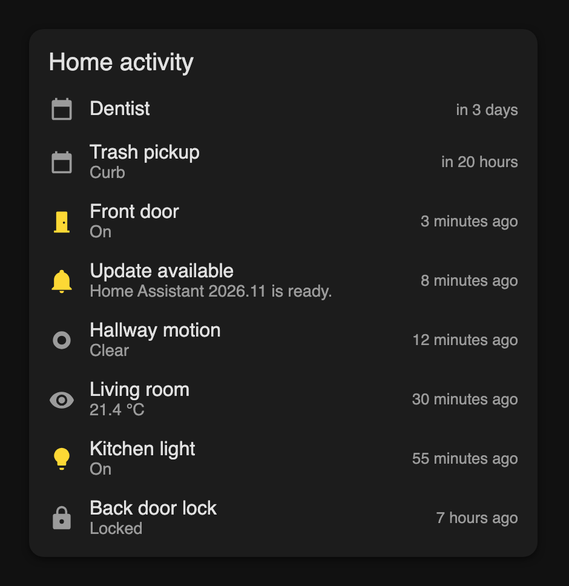

# Activity Feed Card

A Lovelace card for Home Assistant that shows one timeline of what just happened: entity changes, upcoming calendar events and persistent notifications. No dependencies, one JavaScript file, a visual editor included.



_The screenshot is rendered from a mocked `hass` object in a test page (see `test/`)._

## Install

HACS: open HACS, search for "Activity Feed Card" under Frontend, download, reload the browser.

Manual: copy `activity-feed-card.js` to `config/www/`, then add a dashboard resource `/local/activity-feed-card.js` of type `JavaScript module`.

## Use

Add the card from the dashboard card picker ("Activity Feed Card") and use the visual editor, or in YAML:

```yaml
type: custom:activity-feed-card
title: Home activity
entities:
  - binary_sensor.front_door
  - entity: lock.back_door
    name: Back door
    more_info_on_tap: false
calendars:
  - calendar.family
id_filter: ^binary_sensor\.motion_
max_item_count: 20
```

| Option | Default | Description |
| --- | --- | --- |
| `title` | `Activity` | Card title. Empty string hides it. |
| `entities` | `[]` | Entity ids, or objects with `entity`, `name`, `icon`, `more_info_on_tap`. |
| `id_filter` | none | Regular expression. Every entity whose id matches is added. |
| `calendars` | `[]` | Calendar entities. `calendar` is accepted as an alias. |
| `days_ahead` | `7` | How far ahead to show calendar events. |
| `show_notifications` | `true` | Include persistent notifications. |
| `max_item_count` | `20` | Maximum rows. |
| `show_icons` | `true` | Show the icon column. |
| `state_color` | `true` | Colour icons of active entities. |
| `more_info_on_tap` | `true` | Tap a row to open the entity dialog. |
| `show_empty` | `true` | When false the card hides itself with no rows. |
| `empty_text` | `Nothing to show` | Text for an empty card. |

Rows are sorted by timestamp, newest first. Entity rows use the entity's `last_changed`, notifications use their creation time, calendar events use their start time (so upcoming events sit at the top).

## Coming from `home-feed-card`

The option names `title`, `entities`, `calendars`, `id_filter`, `max_item_count`, `show_empty`, `more_info_on_tap` and `state_color` carry over, so for simple setups you can change `type: custom:home-feed-card` to `type: custom:activity-feed-card`. Options this card does not implement (for example `card_id`, `multiple_items`, `content_template`) are ignored. This is an independent project and not affiliated with that card.

## Known limits

- The visual editor edits plain entity ids. Rows written in object form (custom name or icon) are kept in YAML; switch to the code editor for those.
- Tested with a mocked `hass` object in jsdom and headless Chromium. Not yet tested on a live Home Assistant install; please open an issue if something differs on yours.

## Development

```
npm install
npm test
```

## License

MIT
